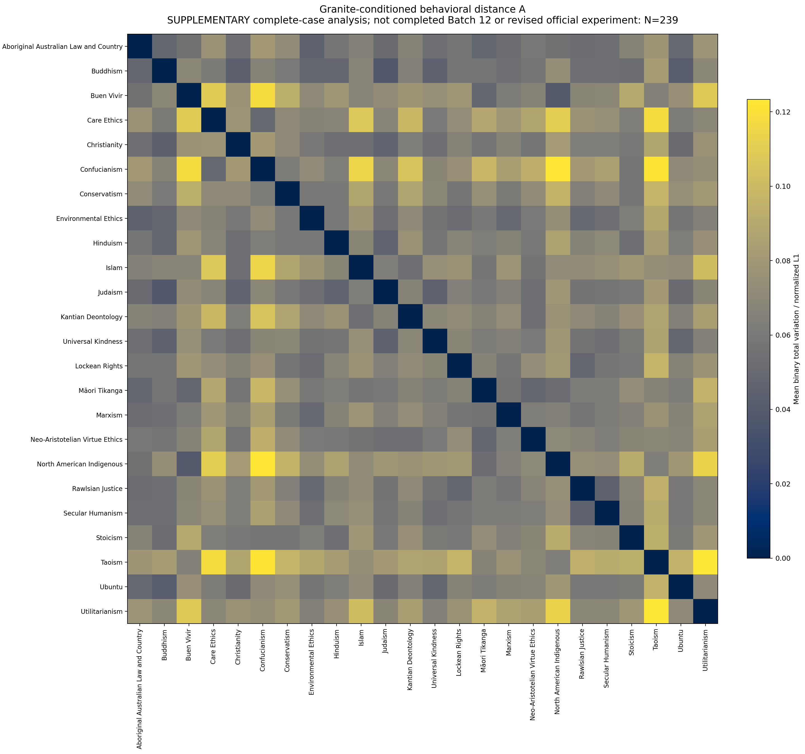

# Constitutional Behavioral Distance: Experimental Prototype

We compare constitutional prompts through the binary action distributions they induce in a fixed language model over shared dilemmas. The resulting behavioral distance is an operational reference for evaluating cheaper constitution distances, including text embeddings and direct comparisons by a fixed panel of AI evaluators.

**Current finding:** The pipeline measures a reproducible, nontrivial model-conditioned behavioral pseudometric, but agreement with illustrative intuitive relationships is mixed. The semantic suitability of this particular behavioral reference remains unresolved.

Data collection is **paused**. The official completed-batch analysis covers **220 scenarios**; a separate **239-scenario complete-case supplement** includes fully observed cases from incomplete Batch 12. Neither is the full 1,336-scenario result.

## 1. Mathematical formulation

Fix a model $M$, constitutions $c$, scenarios $s$, and presentation conditions $k$. Each scenario has its original `to_do` action $a_1(s)$ and `not_to_do` action $a_0(s)$. For each request, obtain genuine next-token log probabilities $\ell_0$ and $\ell_1$ for the two answer digits. Define

$$
r_{c,s,k}=\frac{\exp(\ell_1)}{\exp(\ell_0)+\exp(\ell_1)}.
$$

This is the probability of token `1` **conditional on the next token being either `0` or `1`**. The semantic probability $p_{c,s,k}$ is $r_{c,s,k}$ when `1` denotes `to_do`, and $1-r_{c,s,k}$ when the labels are swapped. Thus every reported probability refers to the same original action, not the same digit. Unconditional token probabilities and their sum remain separately recorded; sampled answers and self-reported confidence are not measurements of $p$.

The induced action distribution is $P_{c,s,k}=\mathrm{Bern}(p_{c,s,k})$. For binary distributions,

$$
\mathrm{TV}\bigl(\mathrm{Bern}(p),\mathrm{Bern}(q)\bigr)=|p-q|.
$$

Averaging these absolute differences across scenarios gives **mean binary total variation**, equivalently normalized L1 between scalar action-probability vectors. “Summed L1” sums those scalar differences; the L1 distance between the full two-component Bernoulli probability mass functions is instead **twice** TV. The three distances below use the scalar-vector convention and have normalized values in [0, 1].

These constructions are **pseudometrics** on constitutional texts: symmetric, nonnegative, zero on the diagonal, and satisfying the triangle inequality, while distinct texts may induce identical finite behavioral profiles. Model, scenario, and presentation dependence are part of the definition.

## 2. Constitutions and evaluation dilemmas

### Constitutions

We use the **24 aligned anchors** from [Constitutional-Evals/constitutions](https://github.com/Constitutional-Evals/constitutions/tree/c34525f09629efe79d236837f89c022e64281363/anchors), pinned at `c34525f09629efe79d236837f89c022e64281363`. The sole substantive preprocessing recursively removes embedded `scenario`/`scenarios` example fields to avoid potential overlap with external evaluation dilemmas; all remaining contents and provenance are preserved.

The [cleaned anchors](data/constitutions/), [exact frozen experiment files](data/granite-exploratory/constitutions/), and [full names and IDs](results/granite-exploratory/supplementary-complete-case-0239/constitutions.csv) are linked here. [Source attribution](data/constitutions/SOURCE.md) records CC BY 4.0 licensing and upstream notices, including EigenBench-derived anchors. Matrix labels refer to these particular specifications, not definitive representations of entire traditions.

### Evaluation dilemmas

We use [`kellycyy/daily_dilemmas`](https://huggingface.co/datasets/kellycyy/daily_dilemmas), configuration `Dilemmas_with_values_aggregated`, **test split**: 2,720 action-level rows representing 1,360 unique dilemmas. Rows are paired by `dilemma_idx`, retaining the original `dilemma_situation` and both `to_do`/`not_to_do` actions. Explicit action choices avoid treating every situation as a grammatical yes/no question. Neither `values_aggregated` nor `negative_consequence` annotations enter prompts.

[Automated screening](data/audit/) flagged 15 ambiguous cases and nine requiring review. The investigator-approved policy excludes all 24 and retains **1,336 scenarios**, without rewriting situations or actions. This is automated screening, not individual human certification. The [original library](data/scenarios-v2.jsonl) and [frozen selected inputs](data/granite-exploratory/) preserve provenance and topic metadata.

The scenarios are shuffled once with seed `20261021`: 66 batches of 20 and a final batch of 16. The approved design contains **128,256 primary evaluations** (24 × 1,336 × 4), plus **5,344 separate baseline evaluations** (1,336 × 4).

## 3. Model and experimental protocol

### Model selection

Initial hosted **Llama 3.3 70B Instruct** experiments showed substantial variation in raw next-token log probabilities under nominally identical requests. The [reproducibility diagnostics](docs/reproducibility-diagnostics.md) traced the variation to the returned measurements, rather than the distance formula or application-side probability extraction. We then [compared 12 model/provider configurations covering 10 model identities](docs/cloud-api-comparison.md), testing genuine two-label logprob support, numerical repeatability, and practical suitability. **Granite 4.0 H Micro pinned to Cloudflare was the only tested configuration to satisfy the repeatability criteria across the complete main comparison dataset.** This finding concerns those tested endpoints and settings, not inherent limitations of all other models.

The selection study returned **326/326 valid Granite responses**, with exactly repeatable raw label logs across identical requests in sequential and concurrent phases, including intermediate-probability cases. All 24 full constitutional prompts fit the endpoint (2,571–3,728 prompt tokens in the coverage check) and produced distinct, nontrivial constitution-conditioned profiles. The subsequent [Granite pilot](results/granite-final-pilot/REPORT.md) found exactly matching raw logs, log odds, and conditional probabilities across **2,168 identical-request pairs**. These observations establish API repeatability in the tested windows, not immutable backend weights, uncached numerical execution, or indefinite service stability.

We selected Granite for repeatable probability measurement and practical hosted inference, **not demonstrated superiority in constitutional fidelity or general capability**. It is a relatively small open-weights instruction model (approximately **3.2B parameters**); the pilot found mixed fidelity, and observed log odds appear quantized at approximately **0.125** increments. The selected model/provider is therefore part of this particular behavioral reference.

### Frozen inference and prompting

The evaluator is `ibm-granite/granite-4.0-h-micro` through **OpenRouter**, pinned exclusively to **Cloudflare**. Weights are not fine-tuned for individual constitutions. The [immutable manifest](configs/granite-exploratory-approved.json) contains complete prompt templates, settings, and scientific source/input hashes.

| Parameter | Frozen value |
|---|---|
| Temperature / top-p | `1` / `1` |
| Maximum output tokens | `1` |
| Next-token logs / top entries | `logprobs: true`, `top_logprobs: 20` |
| Provider selection | `provider.only: ["cloudflare"]` |
| Fallbacks | `provider.allow_fallbacks: false` |
| Required parameters | `provider.require_parameters: true` |

Every request has exactly two ordered messages: `system`, then `user`. The system message supplies fixed decision instructions and the constitution JSON; the user message supplies the original dilemma and explicitly labeled actions. Within each condition, only constitution instructions vary across constitutions. Archived prompt/request hashes verify this against the frozen task plan.

The answer instruction requires one ASCII digit. Valid measurements require **both** finite literal next-token logs, with token bytes `0` = 48 and `1` = 49. We retain raw logs, unconditional probabilities, binary token mass, semantic conditional probabilities, and response metadata. Normalization uses a stable sigmoid of the log-probability difference; missing or invalid distributions are never imputed or replaced by sampled answers. The lowest binary mass among the 23,999 archived valid scientific responses in the archived offline audit was approximately **0.997221**, so conditioning remains explicit even when most mass is on the permitted labels.

### Four counterbalanced conditions

The pilot found substantial label and action-order effects. Every constitution–scenario pair is therefore evaluated once under each condition:

| Condition | `to_do` label | `not_to_do` label | Action-line order |
|---|---|---|---|
| Canonical | 1 | 0 | `to_do` first |
| Labels swapped | 0 | 1 | `to_do` first |
| Order reversed | 1 | 0 | `not_to_do` first |
| Both reversed | 0 | 1 | `not_to_do` first |

Only the two action-label lines change order; the original situation remains verbatim, including ordering implicit in its prose. All probabilities are reoriented to `to_do`. The counterbalanced representation is

$$
q_{c,s}=\frac{1}{4}\sum_{k=1}^{4}p_{c,s,k}.
$$

This is a uniform mixture of the four **already label-conditioned** Bernoulli distributions, without weighting conditions by their unconditional binary token mass. Counterbalancing avoids choosing one label/order convention; it does not guarantee invariance to other presentation changes.

### Three behavioral distances

For a common set of $N$ scenarios, retain:

**A — Primary: distance between counterbalanced probabilities**

$$
D_A(c,d)=\frac{1}{N}\sum_{s=1}^{N}|q_{c,s}-q_{d,s}|.
$$

**B — Secondary: average condition-specific distance**

$$
D_B(c,d)=\frac{1}{4N}\sum_{k=1}^{4}\sum_{s=1}^{N}|p_{c,s,k}-p_{d,s,k}|.
$$

**C — Robustness: canonical-prompt distance**

$$
D_C(c,d)=\frac{1}{N}\sum_{s=1}^{N}|p_{c,s,\mathrm{canonical}}-p_{d,s,\mathrm{canonical}}|.
$$

All three are pseudometrics. By the triangle inequality, $D_A(c,d)\le D_B(c,d)$: **averaging probabilities before measuring distance differs from averaging distances**. A marginalizes presentation condition; B retains condition-specific differences; C uses canonical prompting alone. Summed-L1 versions are $N D_A$, $N D_B$, and $N D_C$; B still averages over its four conditions.

### Baseline and reliability controls

The separate no-constitution baseline uses the same dilemmas and four conditions, with ordinary-moral-judgment instructions instead of constitution JSON. It measures shifts associated with constitutional conditioning, not certified ethical fidelity: wording, length, and framing also change. Baselines do not enter the 24 × 24 constitution matrices.

Requests, model/provider checks, raw distributions, and immutable task identities are preserved, with repeated reference requests (“canaries”) to detect drift. Valid measurements survive interruptions; missing distributions remain explicit. Reported provider identity cannot independently attest internal weight revisions or hardware.

## 4. Preliminary results

### Analysis scopes and verification

Batches **1–11 are complete**, making the **220-scenario prefix** the latest official completed-batch analysis. Batch 12 remains stopped: **Ubuntu × scenario `29912` × `labels_swapped`** lacks a valid probability, and six final scheduled quality-control checks remain outstanding. Across the first 240 scheduled scenarios, archives contain 23,039/23,040 valid primary probabilities, all 960 baselines, and 372 canary responses.

The **supplementary 239-scenario complete-case analysis** combines the first 220 scenarios with 19 fully observed Batch 12 scenarios. It excludes **all of scenario `29912`** for every constitution, condition, and baseline, without imputation or pairwise deletion. Its other 95 valid primary measurements and four baselines remain in the original archives. The common supplementary grid contains **22,944 primary and 956 baseline measurements**; [exact included IDs and hashes](results/granite-exploratory/supplementary-complete-case-0239/analysis-manifest.json) document selection. This is neither completed Batch 12 nor a revised approved scenario set. Complete-case availability may introduce selection effects.

The [previous offline verification](results/granite-exploratory/supplementary-complete-case-0239/verification-report.json) reconstructed every semantic probability from raw token logs and exact frozen requests. All five official probability matrices and six A/B/C exports matched **exactly, including CSV bytes**. Independent scalar calculations checked every distance entry; completeness, probability ranges, symmetry, zero diagonals, nonnegativity, triangle inequalities, and $D_A\le D_B$ passed.

### Distance summaries and full matrices

Means below use all **276 unordered constitution pairs**, excluding the diagonal. Both analysis scopes and all normalized/summed matrices remain available.

| Scope | Metric | Mean normalized distance | Minimum | Maximum |
|---|---|---:|---:|---:|
| Official 220 | A | 0.0691211601 | 0.0392792094 | 0.1235297776 |
| Official 220 | B | 0.0847139446 | 0.0503270674 | 0.1417451546 |
| Official 220 | C | 0.0825833708 | 0.0385924428 | 0.1803448095 |
| Supplementary 239 | A | 0.0693324511 | 0.0384143179 | 0.1233017877 |
| Supplementary 239 | B | 0.0847545546 | 0.0509177694 | 0.1419957602 |
| Supplementary 239 | C | 0.0839129338 | 0.0412930730 | 0.1837688760 |

- **Official 220:** [primary A CSV](results/granite-exploratory/cumulative-through-0011/distances-A_primary-normalized-l1.csv), [full-name 24 × 24 table](results/granite-exploratory/supplementary-complete-case-0239/official-220-reconstruction/primary-distance-table.md), [all official outputs](results/granite-exploratory/cumulative-through-0011/).
- **Supplementary 239:** [primary A CSV](results/granite-exploratory/supplementary-complete-case-0239/distances-A_primary-normalized-l1.csv), [full-name 24 × 24 table](results/granite-exploratory/supplementary-complete-case-0239/primary-distance-table.md), [standalone accessible HTML](results/granite-exploratory/supplementary-complete-case-0239/primary-distance-table.html) (download and open), [all supplementary outputs](results/granite-exploratory/supplementary-complete-case-0239/), including four condition-specific probability matrices and baseline.



[Accessible SVG](results/granite-exploratory/supplementary-complete-case-0239/primary-distance-heatmap.svg) · [PDF](results/granite-exploratory/supplementary-complete-case-0239/primary-distance-heatmap.pdf). Axes follow the immutable constitution order, not a clustering; the tables supply exact values independently of color.

### Four illustrative qualitative comparisons

Ranks are **closest-first among 276 pairs**, computed before rounding; exact ties receive their minimum rank. These investigator-supplied examples are face-validity checks, not a preregistered benchmark.

| Pair | Expectation | Official 220 A (rank) | Supplementary 239 A (rank) |
|---|---|---:|---:|
| Lockean Rights–Marxism | Distant | 0.0574327352 (55/276) | 0.0585908781 (68/276) |
| Utilitarianism–Kantian Deontology | Distant | 0.0812211681 (232/276) | 0.0839813601 (238/276) |
| Ubuntu–Care Ethics | Close | 0.0610431835 (92/276) | 0.0621819200 (96/276) |
| Buen Vivir–Environmental Ethics | Close | 0.0717864050 (181/276) | 0.0712862406 (170/276) |

**Agreement is mixed:** Utilitarianism–Kantian Deontology is relatively distant; Ubuntu–Care Ethics is closer than typical under A, though not among the closest. Lockean Rights–Marxism is unexpectedly close, while Buen Vivir–Environmental Ethics is not especially close. [All four pairs’ A/B/C distances and ranks in both scopes](results/granite-exploratory/supplementary-complete-case-0239/qualitative-expectations.md) show that alternative metrics change rankings without consistently recovering expectations: Ubuntu–Care Ethics is farther than typical under B and C. Four examples do not establish philosophical validity.

For supplementary A, the closest pair is **Buddhism–Judaism**, 0.0384143179 (rank 1); the farthest is **Taoism–Utilitarianism**, 0.1233017877 (rank 276). The [complete ranked list](results/granite-exploratory/supplementary-complete-case-0239/pairs-A_primary-ranked.csv) reports every pair. These are model-conditioned observations, not established explanations of ethical relationships.

### Sensitivity and numerical resolution

**Scenario selection.** From 200 to 220 cumulative scenarios, primary-distance Spearman correlation was approximately **0.996**, with **23/24** nearest neighbors unchanged. Because prefixes overlap, this overstates independent evidence of stability: two **disjoint 110-scenario subsets** gave approximately **0.800**, with **13/24** nearest neighbors matching. See [official diagnostics](results/granite-exploratory/cumulative-through-0011/scientific-diagnostics.json) and [disjoint analysis](results/granite-exploratory/cumulative-through-0011/disjoint-first-0110-vs-next-0110/summary.json).

**Presentation.** Official 220-scenario mean absolute label-mapping and action-line-order effects were **0.290** and **0.170**; supplementary values were **0.283684** and **0.167269**. These descriptive factorial contrasts exceed the mean A distance but are not measurement-error bounds. Averaging can cancel differences retained by B. Mean absolute counterbalanced constitution-to-baseline shifts were **0.104741** (220) and **0.105475** (239), demonstrating changed behavior rather than certified constitutional fidelity.

**Resolution and scope.** Every valid scientific record in the offline audit had log odds within $10^{-5}$ of a **0.125 grid**; long returned decimals do not imply arbitrarily precise underlying logits. The API does not establish the cause or rule out all clipping. Small-model fidelity is imperfect, binary scenarios cover limited behavior, and automated screening can miss action ambiguity. These properties constrain interpretation without invalidating the operational construction.

## 5. Interpretation and proof of concept

We have demonstrated reproducible measurement of model-induced action distributions and a nontrivial behavioral pseudometric. This is a direct reference for the specified model, scenario collection, and presentation protocol; its preliminary agreement with intuitive constitutional relationships is mixed. Imperfect fidelity and dependence on these choices are properties to study, not mathematical failures.

More efficient distances can be evaluated against this reference. Successful agreement means predicting the specified model-conditioned geometry—including its unexpected relationships—not automatically validating model-independent philosophical similarity.

## 6. Research directions

Use the behavioral reference to compare **text-embedding distances** and **similarity structures recovered by a fixed panel of AI evaluators directly comparing constitutions**. The question is whether cheaper methods approximate this geometry without repeatedly eliciting constitution-conditioned behavior across the scenario library. Evaluate distance error, rank correlation, and nearest-neighbor agreement, including generalization beyond these 24 constitutions; claims about unseen constitutions require holding out entire constitutions rather than only pairs sharing training inputs.

## 7. Repository navigation and offline reproducibility

| Path | Contents |
|---|---|
| [Frozen manifest](configs/granite-exploratory-approved.json) | Complete templates, settings, scientific source/input hashes |
| [Frozen inputs and task plan](data/granite-exploratory/) | Constitutions, selected scenarios, immutable task identities |
| [Implementation](src/constitution_distance/) | Prompting, probability extraction, execution |
| [Granite pilot](results/granite-final-pilot/) | Repetition, counterbalancing, and fidelity evidence |
| [Official 220 outputs](results/granite-exploratory/cumulative-through-0011/) | Completed-prefix probabilities, distances, diagnostics |
| [Supplementary 239 outputs](results/granite-exploratory/supplementary-complete-case-0239/) | Complete-case matrices, tables, figures, provenance |
| [Partial Batch 12](results/granite-exploratory/batch-0012/) | Existing measurements and explicitly missing evaluation |

Scientific experiment run ID:

```text
03473f2875b447f77273de536b3b8af4c9d94293380a5cabe8b2cd0a1bf5fd9e
```

This is a self-contained subproject. From an activated Python environment,
install from the monorepo root with `pip install -e ./behavioral-tvd-granite-anchor`,
or from this directory with `pip install -e .`. Run the following scientific
commands **from `behavioral-tvd-granite-anchor/`**, not the monorepo root. The
shown `.venv/bin/python` assumes a virtual environment created in this directory;
with another activated environment, use its `python` instead.

See [migration and portability notes](MIGRATION.md) and
[third-party attribution and license status](THIRD_PARTY_NOTICES.md).

The recorded offline environment is Python **3.12.14**, NumPy **2.2.5**, SciPy **1.15.3**, and Matplotlib **3.10.3**. From the repository root, the existing environment supports:

```bash
# Offline reconstruction from archived raw logs; blocks network connections.
PYTHONPATH=src .venv/bin/python scripts/analyze_granite_research_supplement.py \
  --output /tmp/granite-research-reproduction

# Local fixture/mock tests; no inference dispatch.
PYTHONPATH=src .venv/bin/python -m unittest discover -s tests -v
```

These are reproduction instructions; [migration validation](MIGRATION.md) records their portability checks. Reconstruction needs no credentials, model weights, GPU libraries, or ledger access. The [analysis manifest](results/granite-exploratory/supplementary-complete-case-0239/analysis-manifest.json) records included IDs, archive/input hashes, software versions, and script hash. Existing [rerun verification](results/granite-exploratory/supplementary-complete-case-0239/reproduction-check.json) records 47 byte-identical artifacts; the [prior test report](results/granite-exploratory/supplementary-complete-case-0239/tests.txt) records 86 passing tests. Preserve original inputs and measurements when reproducing; earlier Llama and provider studies are historical, separate experiments.

Operational history is linked separately in the [progress report](results/granite-exploratory/PROGRESS.md), [reviewed recovery](docs/granite-batch12-reviewed-recovery.md), and [stopped-run report](docs/granite-batches12-14-stopped.md).

## 8. Status

**The experiment remains paused; Batch 12 is unchanged and incomplete.** No missing value has been imputed, and the migration does not authorize inference or changes to the experiment. Completing the intended scenario collection requires separate authorization. These preliminary distances remain an operational behavioral reference whose broader semantic suitability is unresolved.
