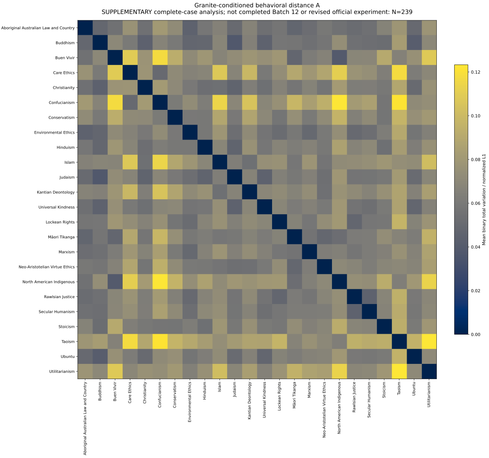

# Supplementary 239-scenario complete-case analysis (offline only)

This is **not** completed Batch 12 and **not** a revision to the official 220-scenario analysis or frozen experiment. Dilemma **29912** is excluded for all constitutions and conditions because Ubuntu × 29912 × labels_swapped has no genuine probability. No value is imputed. The other 95 valid primary measurements and four baselines for that dilemma remain in their original archives.

The analysis independently reconstructs every value from raw label logs and exact frozen requests; its official 220 reconstruction agrees exactly with all committed probability and A/B/C CSV values. See [verification](verification-report.json) and [manifest with exact 239 IDs](analysis-manifest.json). The common grid has 24 constitutions × 239 scenarios × four conditions, plus matching baselines.

- [Full human-readable primary table](primary-distance-table.md) · [accessible standalone HTML](primary-distance-table.html)
- [Primary CSV](distances-A_primary-normalized-l1.csv) · [SVG heatmap](primary-distance-heatmap.svg) · [PNG](primary-distance-heatmap.png) · [PDF](primary-distance-heatmap.pdf)
- [Full constitution names](constitutions.csv) · [All four expectations, A/B/C in both scopes](qualitative-expectations.md)
- [Official 220 independent reconstruction](official-220-reconstruction/) · [Original official exports](../cumulative-through-0011/)

Primary A compares four-condition averaged semantic probabilities; B averages the four condition-specific distances; C uses canonical alone. Normalized distances divide summed-L1 by 239 (or 220 for the separately reconstructed official scope). These are mean binary total variation, not full two-component distribution L1 (which is twice TV).

Reproduce from repository root: `PYTHONPATH=src .venv/bin/python scripts/analyze_granite_research_supplement.py --output /tmp/granite-research-reproduction`. This script has no API client and actively blocks network connections. It never opens a ledger, changes inputs, authorizes tasks, or dispatches inference. Existing source measurements and official outputs are hash-checked unchanged.

